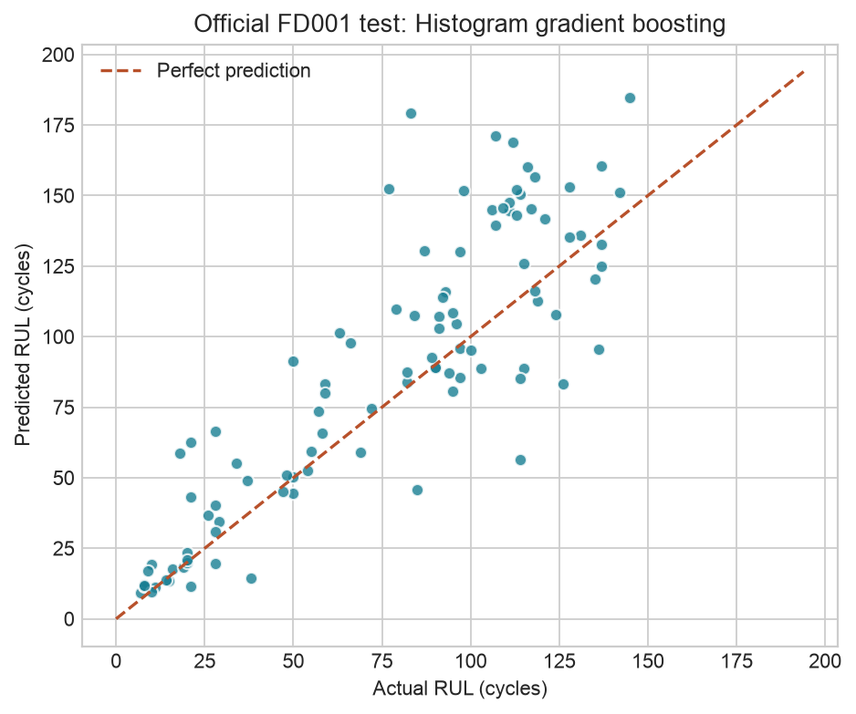
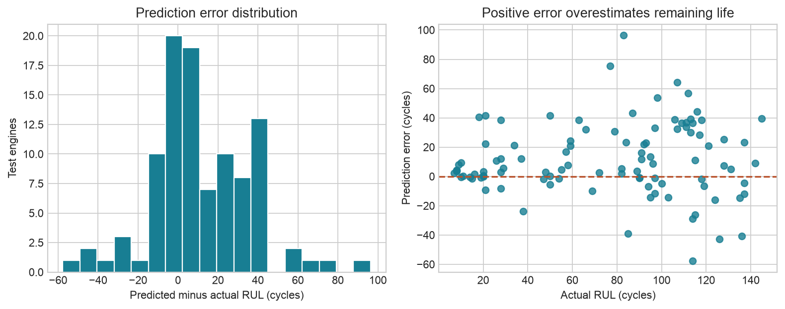

# Aircraft Engine Health Monitoring

**Remaining useful life prediction · NASA C-MAPSS FD001 · Python**

**Research question:** Can observed engine age and sensor history improve remaining useful life (RUL) prediction over a mean predictor and a linear model for unseen engines?

This reproducible study uses NASA's **simulated turbofan data**: 100 run-to-failure training engines and 100 truncated test engines, under one operating condition and one fault mode. It compares a mean baseline, Ridge regression, and histogram gradient boosting using engine-level validation and features available at the prediction cycle.

## Key Findings

- **Gradient boosting outperformed both baselines under the stated validation protocol:** RMSE **31.57 cycles**, versus **35.37** for Ridge and **46.68** for the mean baseline.
- On the **100 official test engines**, the selected model achieved **19.64-cycle MAE** and **27.08-cycle RMSE**.
- Predictions **overestimated true RUL by 11.48 cycles on average**. MAE and RMSE alone do not show this direction, which matters when interpreting possible reliability applications.

The dashed line marks perfect prediction; points above it overestimate remaining life.

## Model Comparison

All three models use the same fit engines, features, and held-out validation checkpoints. Scores below are in cycles against **uncapped** RUL; lower MAE/RMSE is better.

| Model | Validation MAE | Validation RMSE |
|---|---:|---:|
| Mean baseline | 39.76 | 46.68 |
| Ridge regression | 30.32 | 35.37 |
| Histogram gradient boosting | **24.99** | **31.57** |

The mean model provides a condition-independent reference, Ridge an additive reference, and boosting a nonlinear alternative. Selection used validation RMSE; only the selected model was refitted on all training engines and scored on official test labels. This is a comparison under one fixed protocol, not a significance test or a three-model test-set ranking. [Full comparison](docs/technical_analysis.md#model-comparison) · [Fixed settings](docs/technical_analysis.md#methodology).

## Why the Evaluation Design Matters

- **Hold out engines, not rows.** A fixed seed separates 75 fit engines from 25 validation engines, preventing cycles from the same engine from appearing on both sides. This asks about unseen engines rather than other observations from a partly familiar trajectory.
- **Use only available history.** Current readings and trailing 10-cycle sensor means/standard deviations use cycles at or before prediction time. Preprocessing is fitted on fit engines only. “Causal” here means no future information, not a causal effect on failure.
- **Evaluate before failure.** Held-out engines are retrospectively truncated at 40%, 60%, and 80% of their eventual lifetimes, giving 75 nonzero-RUL checkpoints. Evaluating only complete trajectories' final cycles would make every target zero. Lifetime selects these offline checkpoints and labels, never predictors; the snapshots remain correlated and do not reproduce NASA's test truncation process.

[Target construction, leakage controls, and complete validation protocol](docs/technical_analysis.md#validation-strategy) · [Executed notebook](notebooks/01_fd001_analysis.ipynb)

## Interpreting Prediction Errors

**Signed error = predicted − actual RUL.** Positive values overstate remaining life; negative values understate it. The **+11.48-cycle** mean summarizes direction, while **19.64-cycle MAE** summarizes magnitude. Errors can cancel in the signed mean, and not every prediction is an overestimate.

MAE rises from **9.32 cycles** for actual RUL 0–30 to **27.96 cycles** above 100 in these test data. This shows why one aggregate score is insufficient; different bin sizes, target magnitudes, and absent uncertainty intervals limit the comparison. [All RUL ranges and interpretation](docs/technical_analysis.md#why-examine-rul-ranges).

## Main Limitations

Simulation data, one operating condition, and one fault mode limit external validity. The single engine split, dependent validation snapshots, and mismatch between retrospective checkpoints and official test truncation limit performance claims. Longer training trajectories contribute more rows; sensor associations are descriptive. There are no calibrated uncertainty intervals, real-aircraft validation, measured maintenance outcomes, or safe decision thresholds. This is RUL regression from observed history, with no Boeing involvement or production deployment.

[Complete limitations](docs/technical_analysis.md#limitations) · [EDA and four additional figures](docs/technical_analysis.md#exploratory-data-analysis)

## Reproduce and Inspect

The [reproduction guide](docs/technical_analysis.md#reproducibility) provides clone, Python 3.12 environment, dependency installation, official-data download, analysis, pytest, and notebook-execution commands. The saved [QA record](results/qa.json) documents the completed execution; this documentation review does not retrain the model.

- [Metrics](results/metrics.json), [validation predictions](results/validation_predictions.csv), [test predictions](results/test_predictions.csv), and [error by RUL range](results/test_error_by_rul.csv)
- [Data quality](results/data_quality.json), [sensor summary](results/sensor_summary.csv), [frozen method](results/frozen_method.json), and [source archive/file hashes](results/data_provenance.json)
- [Source modules](src), [workflow scripts](scripts), and [tests](tests)

## Dataset and Development Provenance

Saxena, A. and Goebel, K. (2008). *Turbofan Engine Degradation Simulation Data Set*. NASA Prognostics Data Repository, NASA Ames Research Center. [Official source](https://www.nasa.gov/intelligent-systems-division/discovery-and-systems-health/pcoe/pcoe-data-set-repository/) · [Dataset details and references](docs/technical_analysis.md#dataset). Raw data are downloaded from the official source and excluded from Git.

Development used **OpenAI Codex for code and documentation assistance**. The executed artifacts, QA evidence, and Git history are retained. [Provenance and interpretation boundaries](docs/technical_analysis.md#development-provenance-and-interpretation-boundaries).

## Azure Blob Storage Extension

**Tested locally using Azurite.** The Azure Python SDK uploads three allowlisted derived artifacts to a private local Blob container, lists and downloads them, and verifies SHA-256 hashes and exact byte equality. **Local emulator verified; real Azure not verified.** No Azure cloud resources were provisioned, and the model was not trained on Azure or deployed to Azure infrastructure. The existing experiment and figures are unchanged.

See the [extension guide](docs/azure_storage_extension.md) for local setup, actual integration-test evidence, generated environment-based credentials, and the future `DefaultAzureCredential` option for an authorized real account.
