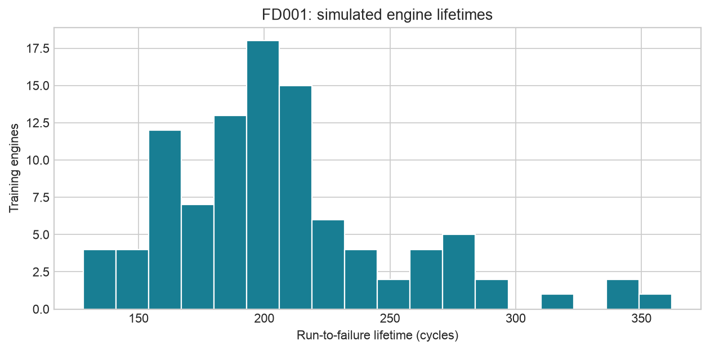
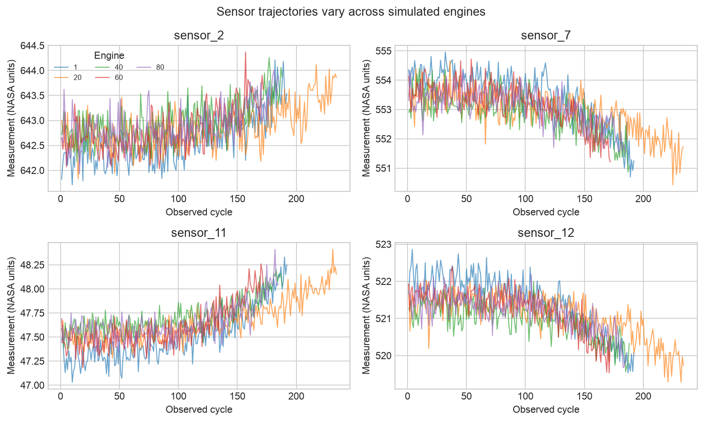
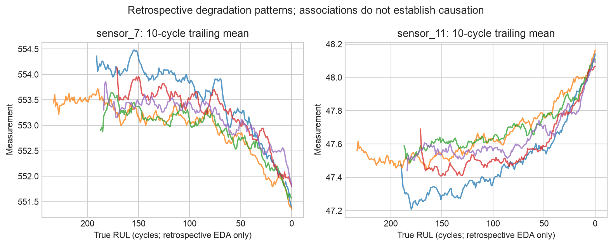
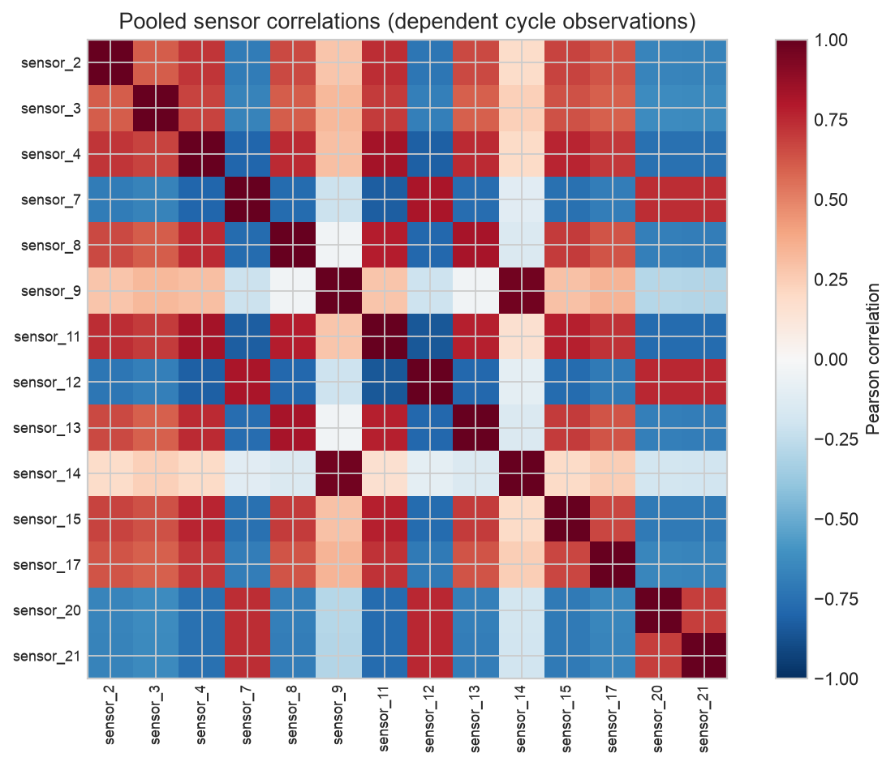

# Aircraft Engine Health Monitoring

### Remaining Useful Life Prediction · NASA C-MAPSS FD001

A compact Python study of **simulated turbofan degradation**, from data quality assessment and exploratory analysis to causal feature engineering and engine-level model evaluation.

**Measured official test performance:** MAE **19.64 cycles**, RMSE **27.08 cycles**, using histogram gradient boosting selected on held-out training engines. Mean signed test error is **+11.48 cycles**: the model tends to overestimate remaining life. This is an educational reliability study, with no Boeing involvement or real-aircraft validation.


## Overview

Remaining useful life (RUL) prediction can inform reliability planning by estimating how many operating cycles remain before a simulated failure threshold. This project asks whether observed engine age and recent sensor history improve regression accuracy over a simple mean predictor on previously unseen engines.

It demonstrates data exploration, schema validation, temporal feature construction, supervised regression, leakage controls, and reproducible evaluation. It does not prescribe maintenance decisions or claim an operational safety benefit.

## Business / Research Question

How accurately can a small, defensible set of models estimate RUL from information available at the current observation? What do data quality, validation design, model complexity, and error bias imply for interpreting the estimates?

Overestimating RUL could delay maintenance; underestimating it could bring unnecessary early maintenance and cost. Those consequences motivate examining signed errors as well as MAE/RMSE, but this project contains no measured maintenance costs or validated decision thresholds.

## Dataset

Source: [NASA Prognostics Center of Excellence repository](https://www.nasa.gov/intelligent-systems-division/discovery-and-systems-health/pcoe/pcoe-data-set-repository/), entry 6, *Turbofan Engine Degradation Simulation*. The [official archive](https://phm-datasets.s3.amazonaws.com/NASA/6.+Turbofan+Engine+Degradation+Simulation+Data+Set.zip) contains the original C-MAPSS data; the download script extracts **FD001 only**, including the nested ZIP.

| Split | Engines | Cycle observations | Meaning |
|---|---:|---:|---|
| NASA training | 100 | 20,631 | Complete run-to-failure trajectories |
| NASA test | 100 | 13,096 | Truncated trajectories; one supplied RUL per engine |

FD001 represents **one operating condition (sea level)** and **one fault mode (high-pressure compressor degradation)** according to the archive's readme. Each observation has 26 numeric fields: engine ID, cycle, three operational settings, and 21 sensors. Sensor numbers retain the original channel identifiers; this project does not invent physical sensor mappings.

The data are simulated, not actual Boeing aircraft measurements. Raw files and archives are excluded from Git; users download directly from the official source. No redistribution license for raw data is assumed. [Provenance](results/data_provenance.json) records the official URL and SHA-256 hashes of the archive and three extracted files. The original archive also includes a data description and the damage-propagation paper.

**Citation:** Saxena, A. and Goebel, K. (2008). *Turbofan Engine Degradation Simulation Data Set*. NASA Prognostics Data Repository, NASA Ames Research Center, Moffett Field, CA.

## Exploratory Data Analysis

- Both splits pass checks for 26 columns, numeric and finite values, positive integer IDs/cycles, unique engine-cycle observations, and ordered contiguous cycles starting at one. No missing values or duplicate observations were found. Integration tests verify IDs 1–100 and the expected row counts.
- Training lifetimes range from **128 to 362 cycles**, with median **199** and mean **206.31**. Individual trajectories differ substantially; row-wise splitting would put the same engine on both sides of evaluation.
- Sensors **1, 5, 10, 16, 18, and 19** are constant in the training data. Sensor 6 also has low absolute spread (standard deviation at most 0.01). Absolute low-variance flags depend on units; they are descriptive, while the model's constant-feature selector is fitted within the training pipeline.
- Selected channels show rising or falling trajectories with noise and differences across engines. Trailing means make these patterns easier to inspect. Associations in this simulation do not establish that a sensor change causes failure.
- Pooled sensor correlations combine within-engine and between-engine variation; cycle observations are dependent. These are descriptive plots, not independent-sample inference.






The degradation plot aligns curves by eventual RUL **only for retrospective EDA**. This alignment is never used as a predictor. Full NASA training EDA is descriptive; the model recipe and comparison protocol are fixed independently of these plots. See [data quality](results/data_quality.json) and [sensor summaries](results/sensor_summary.csv).

## Methodology

**Target.** For NASA training engine i at cycle t, RUL = max observed training cycle for i − t. Full lifetime constructs the supervised label only. Targets are **uncapped**, in cycles, including the final zero-RUL training observation.

**Features.** Current cycle, three settings, 21 current sensor values, and per-sensor trailing **10-cycle means and population standard deviations** (minimum one observation). These give 67 candidate columns before constant removal. Rolling calculations stay within each engine and use only cycles at or before t; the first-cycle standard deviation is zero. Engine ID, future lifetime, and RUL are excluded. Prefix-invariance tests alter future observations and other engines and verify earlier features remain identical.

**Preprocessing.** A shared scikit-learn pipeline performs median imputation, variance filtering (threshold 1e-12), and standard scaling, fitted on fit engines only. Validated FD001 has no missing values, so imputation is a defensive component. Scaling benefits Ridge and is harmless for the other two models. Remaining low-variance features are not removed using test statistics.

**Models.** All settings were fixed in advance; there is no hyperparameter search:

| Model | Fixed specification | Trade-off |
|---|---|---|
| Mean baseline | Mean training-row RUL | Transparent reference; ignores age and condition |
| Ridge | alpha = 10 | Additive and simpler to inspect; correlated features complicate coefficient interpretation |
| Histogram gradient boosting | 150 iterations, learning rate 0.05, 15 maximum leaves, 30 minimum samples/leaf, L2 = 10 | Nonlinear relationships; less direct interpretability |

Boosting early stopping is **disabled**, avoiding an internal random row split. Random seed is 42. All predictions are clipped below at zero, without an upper cap. Every model uses the same predictors, training rows, and validation snapshots. Training minimizes row-weighted loss; longer engines contribute more observations.

## Validation Strategy

1. Split the **100 NASA training engines**, with seed 42, into **75 fit engines / 25 held-out engines**. Engine IDs are disjoint and saved in [frozen_method.json](results/frozen_method.json).
2. For each held-out engine with full lifetime L, evaluate at cycles **floor(0.4L), floor(0.6L), floor(0.8L)**. Each checkpoint precedes failure and gives a nonzero target. There are **75 snapshots**, with three per held-out engine.
3. Explicitly truncate each validation trajectory at its checkpoint, then calculate features from that prefix. Eventual lifetime is used only to select evaluation checkpoints and calculate labels.
4. Rank models by validation **RMSE**, with MAE and model name as deterministic tie-breakers. The pipeline parameters are fitted on the 75 fit engines. No official test features or RUL labels enter selection.
5. Persist the chosen method and source/training hashes, refit it on all 100 NASA training engines, predict each test engine's final observed cycle, and only then read the official labels. NASA label line i is matched to engine i after verifying sorted IDs 1–100.

This avoids both a row-wise split and the misleading complete-trajectory-final-cycle validation task where every label equals zero. Lifetime fractions define a controlled evaluation design; they are **not** the official test censoring process. The 75 snapshots are not independent: they come from 25 engines. A single split is exploratory evidence, not a confidence interval or a robust fleet-level performance guarantee.

## Model Comparison

Validation metrics, in cycles, against uncapped RUL:

| Model | MAE ↓ | RMSE ↓ | Mean error (prediction − actual) |
|---|---:|---:|---:|
| Histogram gradient boosting | 24.99 | 31.57 | +10.53 |
| Ridge | 30.32 | 35.37 | +20.93 |
| Mean baseline | 39.76 | 46.68 | +27.21 |

Gradient boosting was selected by validation RMSE. Its nonlinear fit improves this comparison over the mean and additive Ridge baselines, at the cost of lower direct interpretability. All three models overestimate remaining life on average under this validation protocol. See the complete [comparison](results/model_comparison.csv) and [validation predictions](results/validation_predictions.csv).

## Results

The selected method was refitted on all training engines and evaluated on **100 official test endpoints**:

| Metric | Cycles |
|---|---:|
| MAE | 19.64 |
| RMSE | 27.08 |
| Mean signed error | +11.48 |

Only the validation-selected method was scored on official test labels. No tuning followed inspection of test performance. The notebook independently repeats the same fixed analysis to verify reproducibility; that repeat is not another selection round. Test and validation metrics reflect different engines and truncation distributions, so their difference is not evidence of improved generalization by itself.


Test MAE is **9.32 cycles** for actual RUL 0–30 (25 engines), **13.17** for 31–60 (14), **22.30** for 61–100 (28), and **27.96** above 100 (33). Larger remaining lifetimes are harder under this evaluation. The positive overall bias deserves attention because it overstates the available time until simulated failure. MAE/RMSE do not encode asymmetric maintenance risk.

Machine-readable evidence: [metrics](results/metrics.json), [test predictions](results/test_predictions.csv), [error by RUL range](results/test_error_by_rul.csv), and the [executed notebook](notebooks/01_fd001_analysis.ipynb). These are measured outputs, not manually invented values.

## Limitations

- Simulation data, one operating condition, and one fault mode limit external validity. There is no real-aircraft or external fleet validation.
- Only 100 training engines and one engine-level split; validation snapshots from the same engine are correlated. The pseudo-truncation scheme differs from official test truncation.
- Training uses all cycles and weights longer trajectories more heavily. Engine age can encode simulation-specific lifespan patterns.
- Sensor correlations and retrospective degradation patterns are descriptive, not causal evidence. No uncertainty intervals, maintenance cost model, or safe decision threshold is established.
- Performance is not state of the art and is not a claim of aerospace employment experience, Boeing participation, production deployment, or general-purpose time-series forecasting. The task predicts RUL from observed history, not future sensor trajectories.

## Reproducibility

Tested with **Python 3.12.14** on macOS ARM64. Primary numerical and execution dependencies are pinned in `requirements.txt`; small floating-point differences can occur on other platforms. Python 3.12 is recommended because the exact pinned package versions may not support older interpreters.

```bash
git clone https://github.com/soph1azhao/nasa-cmapss-fd001-rul.git
cd nasa-cmapss-fd001-rul
python3.12 -m venv .venv
source .venv/bin/activate
python -m pip install -r requirements.txt
python scripts/download_data.py
python scripts/run_analysis.py
python -m pytest -q
python scripts/execute_notebook.py
```

The downloader contacts only the official NASA-linked archive and extracts the three required FD001 files. If the official archive is unavailable, report it and consult NASA's catalogue rather than substituting data. Internet access is required for installation and download; fitting and evaluation are local. The notebook executor uses the active Python interpreter and creates a temporary kernel specification, so no global kernel registration is required. It needs permission to open local Jupyter sockets.

The CLI and notebook each run the same deterministic recipe and overwrite generated tables/figures. Re-running reproduces the existing analysis; do not use the official test score to revise the recipe. [QA evidence](results/qa.json) records the actual test and notebook checks. Unit tests use synthetic trajectories; the downloaded-data integration test additionally checks the real FD001 shapes and alignment and skips when raw files have not been downloaded.

```text
src/          Loading, causal features, model selection, evaluation
scripts/      Official download, complete analysis, notebook execution
notebooks/    Executed analysis and interpretation
figures/      Six generated PNG figures
results/      Metrics, quality checks, provenance, frozen recipe, predictions
tests/       Schema, target, causal-prefix, engine split, preprocessing,
              alignment, archive extraction, and fitting-access tests
```

## References

- Saxena, A. and Goebel, K. (2008). *Turbofan Engine Degradation Simulation Data Set*. NASA Prognostics Data Repository, NASA Ames Research Center. [Official dataset repository](https://www.nasa.gov/intelligent-systems-division/discovery-and-systems-health/pcoe/pcoe-data-set-repository/).
- Saxena, A., Goebel, K., Simon, D., and Eklund, N. (2008). *Damage Propagation Modeling for Aircraft Engine Run-to-Failure Simulation*. International Conference on Prognostics and Health Management. Included in the official archive.
